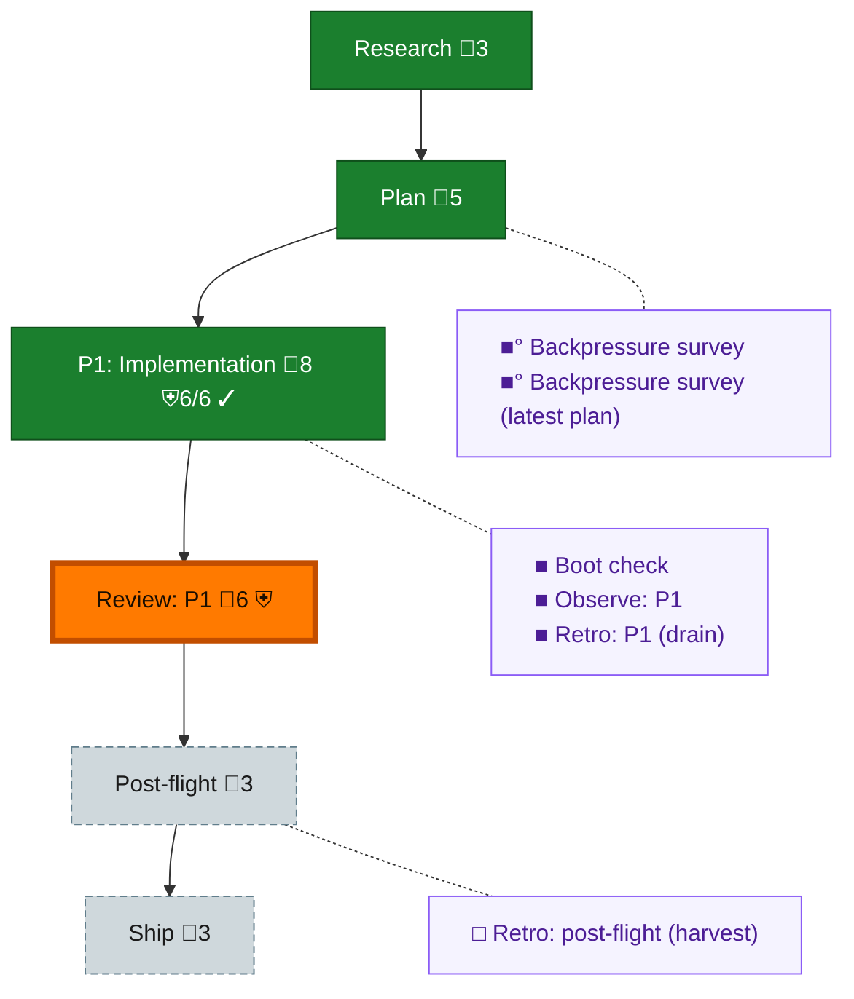

<!-- GENERATED by `harness flow render` — do not hand-edit; regenerate from the flow JSON. -->
# Flow · claude-session-start-adopt

**Kind**: flight-plan · **Now**: review-1 · **Next**: post-flight · **Nodes**: 12 · **Events**: 20

**Rail**: ◆─◆─[ ◆─◐─◇ ]─◇  ◆ Research · ◆ Plan · [ ◆ P1: Implementation · ◐ Review: P1 · ◇ Ship ] · ◇ Post-flight

**Legend** — colour = type/status: 🟩 done · 🟢 in-progress · 🟥 blocked · 🟦 known · ⬜ assumed · 🔶 decision · 🗣 user input · 🟪 harness chore (faded = not yet done) · 🤖 companion · 🛠 worker · 🟧 current (you are here). Badges: 💬 comments · 📄 artifacts · 📝 instructions · 🧰 chore (° optional / recommended / ‼ strongly-recommended; ✓ done · ✕ skipped) · ⛨ dd gate (terminal/total from the last evaluation; ✓ = open). ⛨✓/⛨✕ = a plan-validate check gate (green / not green).

## Node log

### backpressure · Backpressure survey
- `2026-09-02T00:01:33.272Z` · agent · validation — decision:route verdict:Partial basis_sha256:10e83e0702cc3e9a0eb8ac4ba7b6ac49eb53c0cc4b028c6b2ed073a30b734ba8 artifact:docs/plans/127-claude-session-start-adopt/assets/backpressure-coverage.md time:2026-09-02

### boot-1 · Boot check
- `2026-09-02T00:02:46.180Z` · agent · validation — decision:route verdict:healthy typecheck:pass test:pass time:2026-09-02T00:02:00.617Z

### observe-1 · Observe: P1
- `2026-09-02T00:50:52.845Z` · agent · validation — decision:captured record:.harness/temp/agent/session-buffer.md entries:CONF-001,DL-001,DL-002,DL-003,DL-004,DL-005 time:2026-09-02T00:50:42Z

### retro-1 · Retro: P1 (drain)
- `2026-09-02T00:50:53.232Z` · agent · validation — decision:deferred owner:o-prime reason:packet-i8-requires-list-never-clear buffer:.harness/temp/agent/session-buffer.md entries:6 time:2026-09-02T00:50:42Z

### backpressure-151200a981b2 · Backpressure survey (latest plan)
- `2026-09-02T00:10:49.514Z` · agent · validation — decision:route verdict:Partial basis_sha256:151200a981b25780824581308f25160f7517ba3ae828cff238cf11003afc57b1 artifact:docs/plans/127-claude-session-start-adopt/assets/backpressure-coverage.md time:2026-09-02
