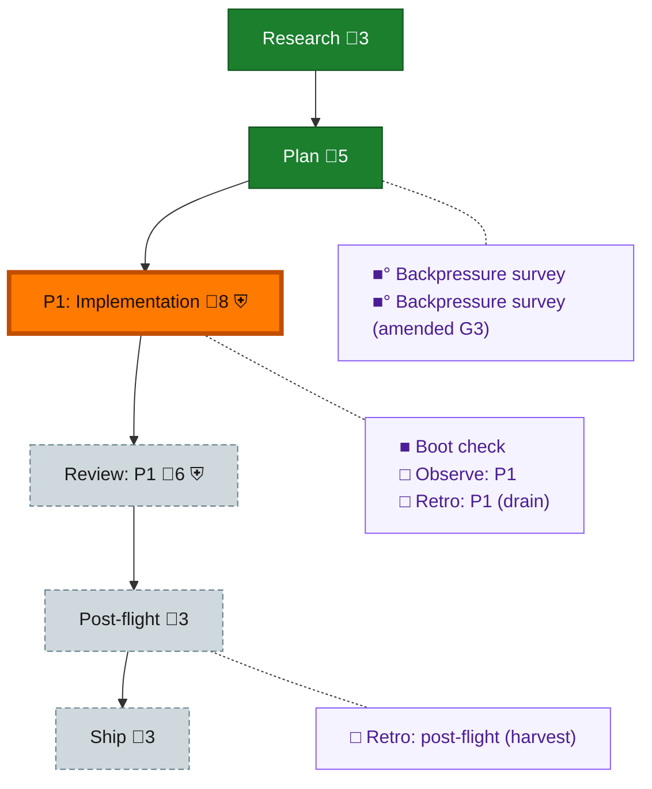

<!-- GENERATED by `harness flow render` — do not hand-edit; regenerate from the flow JSON. -->
# Flow · seat-session-identity

**Kind**: flight-plan · **Now**: phase-1 · **Next**: review-1 · **Intent**: Implement plan 128 seat-session identity · **Nodes**: 12 · **Events**: 15

**Rail**: ◆─◆─[ ◐─◇─◇ ]─◇  ◆ Research · ◆ Plan · [ ◐ P1: Implementation · ◇ Review: P1 · ◇ Ship ] · ◇ Post-flight

**Legend** — colour = type/status: 🟩 done · 🟢 in-progress · 🟥 blocked · 🟦 known · ⬜ assumed · 🔶 decision · 🗣 user input · 🟪 harness chore (faded = not yet done) · 🤖 companion · 🛠 worker · 🟧 current (you are here). Badges: 💬 comments · 📄 artifacts · 📝 instructions · 🧰 chore (° optional / recommended / ‼ strongly-recommended; ✓ done · ✕ skipped) · ⛨ dd gate (terminal/total from the last evaluation; ✓ = open). ⛨✓/⛨✕ = a plan-validate check gate (green / not green).

## Node log

### backpressure · Backpressure survey
- `2026-09-02T00:10:52.933Z` · agent · validation — verdict:completed reason:coverage artifact written basis_sha256:b56d5564b4865271d90840823e1d5cb5aa4eb356908b97e11db7f36d1cbd6720 time:2026-09-02

### boot-1 · Boot check
- `2026-09-02T00:10:53.690Z` · agent · validation — verdict:healthy reason:harness boot passed typecheck and test after canonical node_modules link time:2026-09-02T00:10:24Z

### backpressure-ccd718561165 · Backpressure survey (amended G3)
- `2026-09-02T00:33:40.517Z` · agent · validation — verdict:completed reason:coverage refreshed for rs-first null-fill union basis_sha256:ccd7185611657d1edbca1b8589aa5de233c4a4e0999cb071f106aede2f6c55c6 time:2026-09-02
