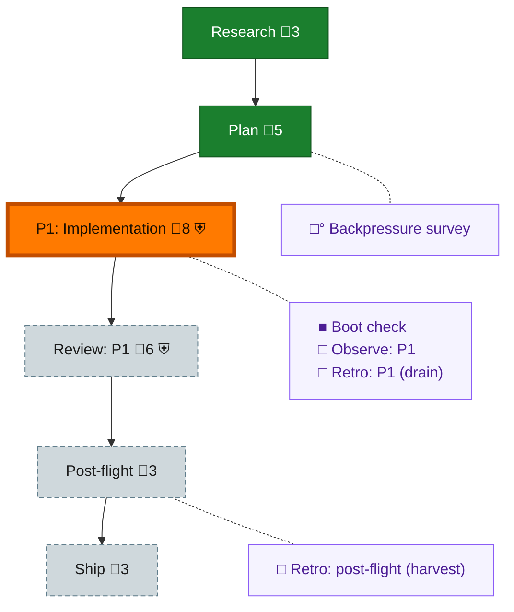

<!-- GENERATED by `harness flow render` — do not hand-edit; regenerate from the flow JSON. -->
# Flow · statusline-generation-badge

**Kind**: flight-plan · **Now**: phase-1 · **Intent**: Show the rs-preferred seat id and generation badge in Claude and omp statuslines · **Nodes**: 11 · **Events**: 9

**Rail**: ◆─◆─[ ◐─◇─◇ ]─◇  ◆ Research · ◆ Plan · [ ◐ P1: Implementation · ◇ Review: P1 · ◇ Ship ] · ◇ Post-flight

**Legend** — colour = type/status: 🟩 done · 🟢 in-progress · 🟥 blocked · 🟦 known · ⬜ assumed · 🔶 decision · 🗣 user input · 🟪 harness chore (faded = not yet done) · 🤖 companion · 🛠 worker · 🟧 current (you are here). Badges: 💬 comments · 📄 artifacts · 📝 instructions · 🧰 chore (° optional / recommended / ‼ strongly-recommended; ✓ done · ✕ skipped) · ⛨ dd gate (terminal/total from the last evaluation; ✓ = open). ⛨✓/⛨✕ = a plan-validate check gate (green / not green).

## Node log

### boot-1 · Boot check
- `2026-09-02T01:57:20.671Z` · agent · validation — decision:route verdict:UNHEALTHY reason:harness-boot-test-failed time:2026-09-02T01:57:11.840Z
- `2026-09-02T01:58:20.612Z` · user · decision — decision:continue reason:prime ruled known-main baselines npm-resolution-policy.integration.test.ts replay status 1 and worktree.test.ts cleanup ENOTEMPTY; exclude only these named failures time:2026-09-02T01:58:18Z
