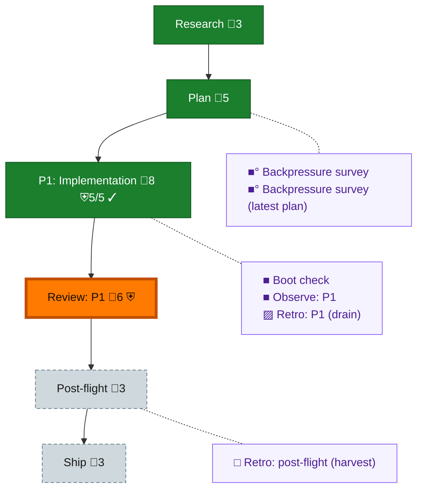

<!-- GENERATED by `harness flow render` — do not hand-edit; regenerate from the flow JSON. -->
# Flow · rs-tap-supersedes-legacy

**Kind**: flight-plan · **Now**: review-1 · **Next**: post-flight · **Intent**: Implement plan 133: rs supersedes legacy taps; deferred pane delivery names its reason and retries · **Nodes**: 12 · **Events**: 20

**Rail**: ◆─◆─[ ◆─◐─◇ ]─◇  ◆ Research · ◆ Plan · [ ◆ P1: Implementation · ◐ Review: P1 · ◇ Ship ] · ◇ Post-flight

**Legend** — colour = type/status: 🟩 done · 🟢 in-progress · 🟥 blocked · 🟦 known · ⬜ assumed · 🔶 decision · 🗣 user input · 🟪 harness chore (faded = not yet done) · 🤖 companion · 🛠 worker · 🟧 current (you are here). Badges: 💬 comments · 📄 artifacts · 📝 instructions · 🧰 chore (° optional / recommended / ‼ strongly-recommended; ✓ done · ✕ skipped) · ⛨ dd gate (terminal/total from the last evaluation; ✓ = open). ⛨✓/⛨✕ = a plan-validate check gate (green / not green).

## Node log

### backpressure · Backpressure survey
- `2026-09-02T04:43:20.923Z` · agent · validation — decision:route verdict:Weak artifact:assets/backpressure-coverage.md time:2026-09-02T04:42:48Z basis_sha256:a89f5c12d4175bac270592d4975622e0fd90ff3fa7c5e79f62ea19ac8fbe263a

### boot-1 · Boot check
- `2026-09-02T04:43:31.582Z` · agent · validation — decision:route verdict:healthy command:harness_boot_json typecheck:pass test:pass time:2026-09-02T04:42:41.482Z

### observe-1 · Observe: P1
- `2026-09-02T05:42:13.196Z` · agent · validation — captures:8 pointer:.harness/temp/agent/session-buffer.md time:2026-09-02T05:42:00.360Z

### retro-1 · Retro: P1 (drain)
- `2026-09-02T05:42:13.504Z` · user · decision — List, never clear — the drain is o-prime-owned.

### backpressure-9b4ccecbf3ac · Backpressure survey (latest plan)
- `2026-09-02T05:07:34.303Z` · agent · validation — decision:route verdict:Weak proof-plan:explicit-cargo-approved no-harness-widening time:2026-09-02T05:07:01Z basis_sha256:9b4ccecbf3acb5c055438208540b21cf85ddd8deae8434a3dc58f057425b5dfa
