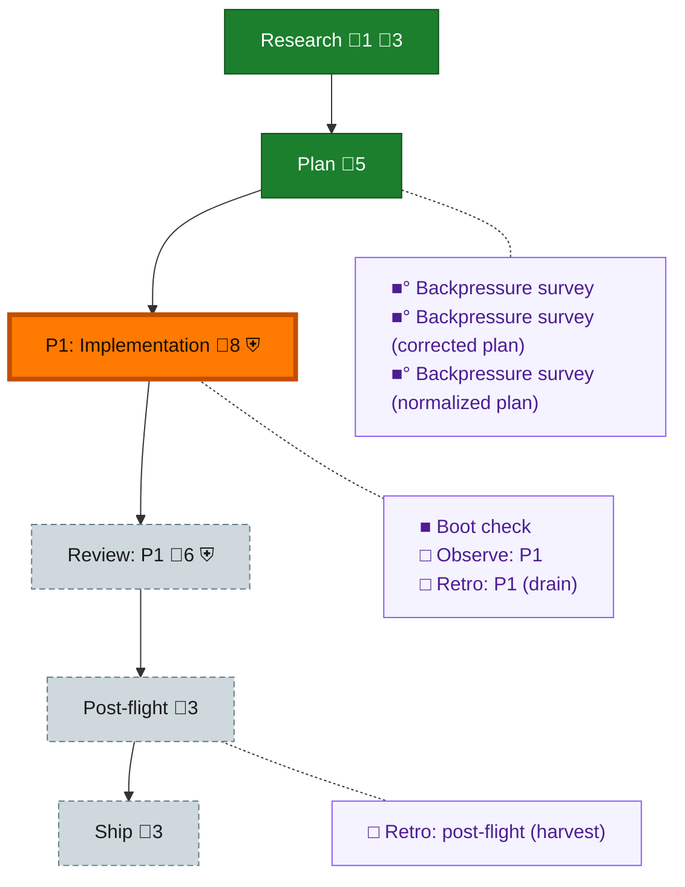

<!-- GENERATED by `harness flow render` — do not hand-edit; regenerate from the flow JSON. -->
# Flow · omp-no-composer-veto

**Kind**: flight-plan · **Now**: phase-1 · **Intent**: Implement plan 134: omp/pi bypass composer veto first, then sender queued/late notices · **Nodes**: 13 · **Events**: 18

**Rail**: ◆─◆─[ ◐─◇─◇ ]─◇  ◆ Research · ◆ Plan · [ ◐ P1: Implementation · ◇ Review: P1 · ◇ Ship ] · ◇ Post-flight

**Legend** — colour = type/status: 🟩 done · 🟢 in-progress · 🟥 blocked · 🟦 known · ⬜ assumed · 🔶 decision · 🗣 user input · 🟪 harness chore (faded = not yet done) · 🤖 companion · 🛠 worker · 🟧 current (you are here). Badges: 💬 comments · 📄 artifacts · 📝 instructions · 🧰 chore (° optional / recommended / ‼ strongly-recommended; ✓ done · ✕ skipped) · ⛨ dd gate (terminal/total from the last evaluation; ✓ = open). ⛨✓/⛨✕ = a plan-validate check gate (green / not green).

## Node log

### research · Research
- `2026-09-02T08:27:43.632Z` · agent · validation — adoption: prime supplied approved plan and implementation guide; no separate research artifact

### backpressure · Backpressure survey
- `2026-09-02T08:30:28.808Z` · agent · validation — decision:route verdict:Partial artifact:assets/backpressure-coverage.md time:2026-09-02 basis_sha256:8c17b73094c945bfb841e36e58259ce5813933af29c9018545f053f81444597a

### boot-1 · Boot check
- `2026-09-02T08:34:31.881Z` · user · decision — verdict:UNHEALTHY typecheck:pass smoke:file-watch-notify-fail elapsed:82.7s ruling:Continue; rerun just smoke once before PR time:2026-09-02

### backpressure-72d773dca800 · Backpressure survey (corrected plan)
- `2026-09-02T08:40:05.832Z` · agent · validation — decision:route verdict:Partial artifact:assets/backpressure-coverage.md time:2026-09-02 basis_sha256:72d773dca80070561a720611764d79cacdcbbc567ec9701b0d533c5f7bbbc4e6

### backpressure-da5ad9f360c7 · Backpressure survey (normalized plan)
- `2026-09-02T08:43:38.996Z` · agent · validation — decision:route verdict:Partial artifact:assets/backpressure-coverage.md time:2026-09-02 basis_sha256:da5ad9f360c738394722d626c46210b46c598edcd201145cd177bdfa0d496a9e
