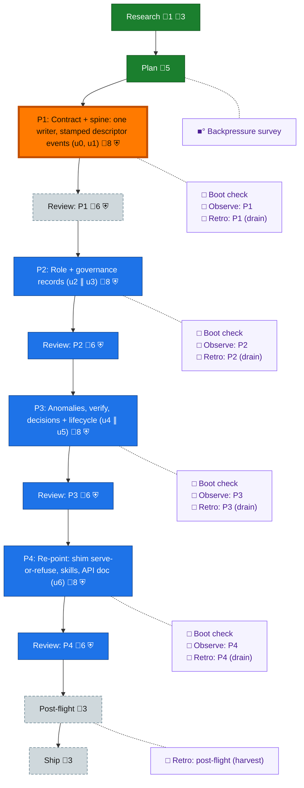

<!-- GENERATED by `harness flow render` — do not hand-edit; regenerate from the flow JSON. -->
# Flow · rs-governance-port

**Kind**: flight-plan · **Now**: phase-1 · **Intent**: Deliver plan 139 under prime ownership; PM freezes wave-zero contracts, composes isolated units and hands off proof · **Nodes**: 26 · **Events**: 26

**Rail**: ◆─◆─[ ◇─◇─◇─◇─◇─◇─◇─◇ ]─◇─◇  ◆ Research · ◆ Plan · [ ◇ P1: Contract + spine: one writer, stamped descriptor events (u0, u1) · ◇ Review: P1 · ◇ P2: Role + governance records (u2 ∥ u3) · ◇ Review: P2 · ◇ P3: Anomalies, verify, decisions + lifecycle (u4 ∥ u5) · ◇ Review: P3 · ◇ P4: Re-point: shim serve-or-refuse, skills, API doc (u6) · ◇ Review: P4 ] · ◇ Post-flight · ◇ Ship

**Legend** — colour = type/status: 🟩 done · 🟢 in-progress · 🟥 blocked · 🟦 known · ⬜ assumed · 🔶 decision · 🗣 user input · 🟪 harness chore (faded = not yet done) · 🤖 companion · 🛠 worker · 🟧 current (you are here). Badges: 💬 comments · 📄 artifacts · 📝 instructions · 🧰 chore (° optional / recommended / ‼ strongly-recommended; ✓ done · ✕ skipped) · ⛨ dd gate (terminal/total from the last evaluation; ✓ = open). ⛨✓/⛨✕ = a plan-validate check gate (green / not green).

## Node log

### research · Research
- `2026-09-07T00:11:02.917Z` · agent · validation — Adopted prime-authored inventory and folded plan 138; see assets/inputs. Plan validate: zero errors, zero warnings, 37 open items.

### backpressure · Backpressure survey
- `2026-09-07T00:23:46.749Z` · agent · validation — decision:unavailable reason:host exposes skill instruction reads but no slash-skill invocation tool; executable eng-harness-flow --hook pre-coding --json attempted and exited 127 time:2026-09-07T00:23:46Z basis_sha256:1a92bb5686c6807c8509e9e4d1db9ef321a20f0faf29f173eef3aee91eb7770d. Manual baseline harness boot evidence remains separate: typecheck pass, file-watch-notify smoke fail.
