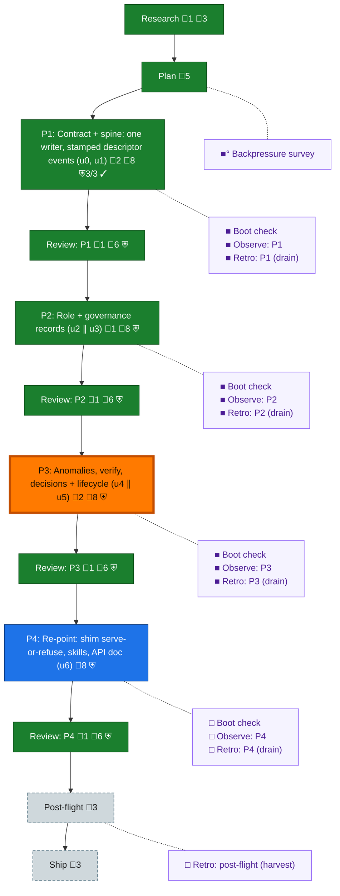

<!-- GENERATED by `harness flow render` — do not hand-edit; regenerate from the flow JSON. -->
# Flow · rs-governance-port

**Kind**: flight-plan · **Now**: phase-3 · **Intent**: Local composition4751923e dual-green and independently approved; phase3 production bp0007 and phase4 tk42/AC2/3/7/9 remain prime-owned. Legacy root-guide ruling retained; no gate bypass, production action, or archive. · **Nodes**: 26 · **Events**: 62

**Rail**: ◆─◆─[ ◆─◆─◆─◆─◐─◆─◇─◆ ]─◇─◇  ◆ Research · ◆ Plan · [ ◆ P1: Contract + spine: one writer, stamped descriptor events (u0, u1) · ◆ Review: P1 · ◆ P2: Role + governance records (u2 ∥ u3) · ◆ Review: P2 · ◐ P3: Anomalies, verify, decisions + lifecycle (u4 ∥ u5) · ◆ Review: P3 · ◇ P4: Re-point: shim serve-or-refuse, skills, API doc (u6) · ◆ Review: P4 ] · ◇ Post-flight · ◇ Ship

**Legend** — colour = type/status: 🟩 done · 🟢 in-progress · 🟥 blocked · 🟦 known · ⬜ assumed · 🔶 decision · 🗣 user input · 🟪 harness chore (faded = not yet done) · 🤖 companion · 🛠 worker · 🟧 current (you are here). Badges: 💬 comments · 📄 artifacts · 📝 instructions · 🧰 chore (° optional / recommended / ‼ strongly-recommended; ✓ done · ✕ skipped) · ⛨ dd gate (terminal/total from the last evaluation; ✓ = open). ⛨✓/⛨✕ = a plan-validate check gate (green / not green).

## Node log

### research · Research
- `2026-09-07T00:11:02.917Z` · agent · validation — Adopted prime-authored inventory and folded plan 138; see assets/inputs. Plan validate: zero errors, zero warnings, 37 open items.

### phase-1 · P1: Contract + spine: one writer, stamped descriptor events (u0, u1)
- `2026-09-07T05:06:20.948Z` · agent · validation — Native phase assertions checked; scoped harness plan validate gate exited0 with0 errors/0 warnings. Source5a8a25013e0bffdabfbcd05438ed19febc26b891 full Rust+engineering GREEN; assets/green-proof-checkpoint.json. Independent final cross-model review remains unperformed. time:2026-09-07T05:06:19Z
- `2026-09-07T05:30:42.824Z` · user · decision — Approved: keep the pij-team documents where they are (root impl-guide.dd.json), do not migrate or duplicate the guide mid-plan; navigate with the existing harness flow and record an explicit legacy-flow receipt for the E470 mismatch; review nodes stay pending until the final pinned cross-model review.

### review-1 · Review: P1
- `2026-09-07T15:45:54.595Z` · agent · validation — verdict:approved-local subject_sha:4751923e6625e53ed3955b4587fdea58dd4eb0fe reviewer:pij-zany-reptile observed:OMP/claude-opus-5/high; report:assets/reviews/review.final-composed.md; machine receipt:assets/reviews/team-review-receipt.dd.json. Exact-pin metadata delta and unchanged runtime reviewed; both full gates green. EXT-001 remains open: no production/chainglass/whole-plan/archive acceptance; this is completion of local review, not a phase-gate override.

### backpressure · Backpressure survey
- `2026-09-07T00:23:46.749Z` · agent · validation — decision:unavailable reason:host exposes skill instruction reads but no slash-skill invocation tool; executable eng-harness-flow --hook pre-coding --json attempted and exited 127 time:2026-09-07T00:23:46Z basis_sha256:1a92bb5686c6807c8509e9e4d1db9ef321a20f0faf29f173eef3aee91eb7770d. Manual baseline harness boot evidence remains separate: typecheck pass, file-watch-notify smoke fail.

### boot-1 · Boot check
- `2026-09-07T00:30:48.348Z` · agent · validation — decision:unavailable reason:no host skill dispatch tool; eng-harness-flow --hook pre-flight --json executable attempt exited 127 time:2026-09-07T00:30:48Z; actual independent harness checks all9 passed at 2026-09-07T00:26:57Z

### observe-1 · Observe: P1
- `2026-09-07T05:06:19.589Z` · agent · validation — captures:1 pointer:.harness/temp/agent/session-buffer.md#DL-008 physical-pipe proof repair time:2026-09-07T05:06:19Z

### retro-1 · Retro: P1 (drain)
- `2026-09-07T05:06:19.869Z` · agent · validation — decision:unavailable reason:same-session host has no skill/slash dispatch mechanism; executable router detection at boot-1 exited127. No drain envelope fabricated; buffer preserved for manual closeout. time:2026-09-07T05:06:19Z

### phase-2 · P2: Role + governance records (u2 ∥ u3)
- `2026-09-07T05:06:21.228Z` · agent · validation — Native phase assertions checked; scoped harness plan validate gate exited0 with0 errors/0 warnings. Source5a8a25013e0bffdabfbcd05438ed19febc26b891 full Rust+engineering GREEN; assets/green-proof-checkpoint.json. Independent final cross-model review remains unperformed. time:2026-09-07T05:06:19Z

### review-2 · Review: P2
- `2026-09-07T15:45:54.859Z` · agent · validation — verdict:approved-local subject_sha:4751923e6625e53ed3955b4587fdea58dd4eb0fe reviewer:pij-zany-reptile observed:OMP/claude-opus-5/high; report:assets/reviews/review.final-composed.md; machine receipt:assets/reviews/team-review-receipt.dd.json. Exact-pin metadata delta and unchanged runtime reviewed; both full gates green. EXT-001 remains open: no production/chainglass/whole-plan/archive acceptance; this is completion of local review, not a phase-gate override.

### boot-2 · Boot check
- `2026-09-07T05:06:20.123Z` · agent · validation — decision:unavailable reason:same-session router/host detection retained from boot-1; no host skill/slash dispatch and executable exited127. Recorded retrospectively, not claimed as a pre-work boot. Independent actual proof: green-proof-checkpoint.json source5a8a250. time:2026-09-07T05:06:19Z

### observe-2 · Observe: P2
- `2026-09-07T05:06:20.379Z` · agent · validation — captures:1 pointer:.harness/temp/agent/session-buffer.md#DL-009 canary protocol proof grade time:2026-09-07T05:06:19Z

### retro-2 · Retro: P2 (drain)
- `2026-09-07T05:06:20.647Z` · agent · validation — decision:unavailable reason:no host skill/slash dispatch; same-session executable router detection exited127. No retro/drain envelope fabricated; buffer preserved. time:2026-09-07T05:06:19Z

### phase-3 · P3: Anomalies, verify, decisions + lifecycle (u4 ∥ u5)
- `2026-09-07T05:06:21.784Z` · agent · validation — Composing initial u4/u5 with u1 conditional mutation and u2 retired refusal amendments; explicit terminal-only supersede recovery in progress. Tests and source checkpoint pending. time:2026-09-07T05:06:19Z
- `2026-09-07T15:20:07.767Z` · agent · validation — Local composed source335d dual-green and independent Opus approval with traceability corrections recorded in lg0014/lg0015. Scoped phase3 schema has zero errors and one open-completable warning: bp0007 includes prime-owned production proof. Preserve this warning and tk42 blocked; no gate bypass or whole-plan completion.

### review-3 · Review: P3
- `2026-09-07T15:45:55.130Z` · agent · validation — verdict:approved-local subject_sha:4751923e6625e53ed3955b4587fdea58dd4eb0fe reviewer:pij-zany-reptile observed:OMP/claude-opus-5/high; report:assets/reviews/review.final-composed.md; machine receipt:assets/reviews/team-review-receipt.dd.json. Exact-pin metadata delta and unchanged runtime reviewed; both full gates green. EXT-001 remains open: no production/chainglass/whole-plan/archive acceptance; this is completion of local review, not a phase-gate override.

### boot-3 · Boot check
- `2026-09-07T05:06:21.506Z` · agent · validation — decision:unavailable reason:no host skill/slash dispatch; same-session executable router detection exited127. No boot envelope fabricated; prior immutable baseline full gates recorded separately. time:2026-09-07T05:06:19Z

### observe-3 · Observe: P3
- `2026-09-07T15:20:07.244Z` · agent · validation — captures:multiple pointer:.harness/temp/agent/session-buffer.md#CONF-003; prior DL-011/DL-012 retained; final buffers preserved, never drained time:2026-09-07T15:20:07Z

### retro-3 · Retro: P3 (drain)
- `2026-09-07T15:20:07.507Z` · agent · validation — decision:unavailable reason:no host skill/slash dispatch; same-session executable router detection exited127. No retro envelope or drain fabricated; source buffers preserved under assets/buffers for prime harvest. time:2026-09-07T15:20:07Z

### review-4 · Review: P4
- `2026-09-07T15:45:55.396Z` · agent · validation — verdict:approved-local subject_sha:4751923e6625e53ed3955b4587fdea58dd4eb0fe reviewer:pij-zany-reptile observed:OMP/claude-opus-5/high; report:assets/reviews/review.final-composed.md; machine receipt:assets/reviews/team-review-receipt.dd.json. Exact-pin metadata delta and unchanged runtime reviewed; both full gates green. EXT-001 remains open: no production/chainglass/whole-plan/archive acceptance; this is completion of local review, not a phase-gate override.
