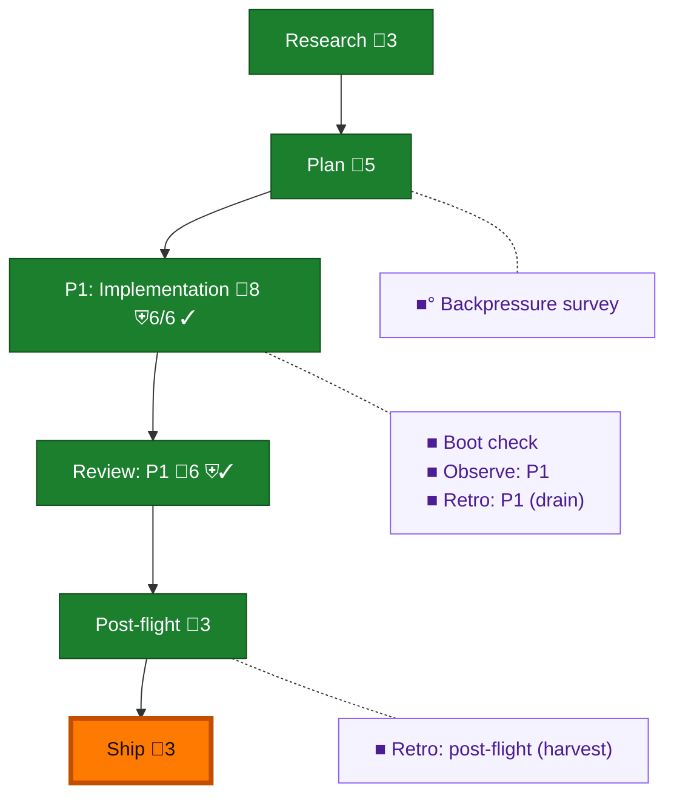

<!-- GENERATED by `harness flow render` — do not hand-edit; regenerate from the flow JSON. -->
# Flow · omp-event-reattach

**Kind**: flight-plan · **Now**: ship · **Intent**: omp/pi extension survives an rs daemon restart and resumes full-body delivery · **Nodes**: 11 · **Events**: 26

**Rail**: ◆─◆─[ ◆─◆─◐ ]─◆  ◆ Research · ◆ Plan · [ ◆ P1: Implementation · ◆ Review: P1 · ◐ Ship ] · ◆ Post-flight

**Legend** — colour = type/status: 🟩 done · 🟢 in-progress · 🟥 blocked · 🟦 known · ⬜ assumed · 🔶 decision · 🗣 user input · 🟪 harness chore (faded = not yet done) · 🤖 companion · 🛠 worker · 🟧 current (you are here). Badges: 💬 comments · 📄 artifacts · 📝 instructions · 🧰 chore (° optional / recommended / ‼ strongly-recommended; ✓ done · ✕ skipped) · ⛨ dd gate (terminal/total from the last evaluation; ✓ = open). ⛨✓/⛨✕ = a plan-validate check gate (green / not green).

## Node log

### backpressure · Backpressure survey
- `2026-09-01T21:22:55.800Z` · agent · validation — decision:route verdict:completed artifact:assets/backpressure-coverage.md basis_sha256:fb3bd3e2a11ab32779c7924d6ae7119cb1473b90904b8ae5ddad6c5995dac97e time:2026-09-01T21:22:51Z

### boot-1 · Boot check
- `2026-09-01T21:25:08.269Z` · agent · validation — decision:route verdict:healthy command:harness_boot typecheck:pass test:pass time:2026-09-01T21:23:50.739Z

### observe-1 · Observe: P1
- `2026-09-01T23:06:36.471Z` · agent · validation — decision:captured record:.harness/temp/agent/session-buffer.md entries:CONF-001,CONF-002,DL-001,DL-002,DL-003 time:2026-09-01T23:06:07Z

### retro-1 · Retro: P1 (drain)
- `2026-09-01T23:06:36.765Z` · agent · validation — decision:redirect owner:o-prime action:list-only buffer-preserved packet:i8 message:p124-retro-list time:2026-09-01T23:06:26Z

### retro-harvest · Retro: post-flight (harvest)
- `2026-09-01T23:07:04.971Z` · agent · validation — decision:route verdict:empty records:0 entries:0 buffer_pending:5 owner:o-prime action:list-only time:2026-09-01T23:06:55Z
