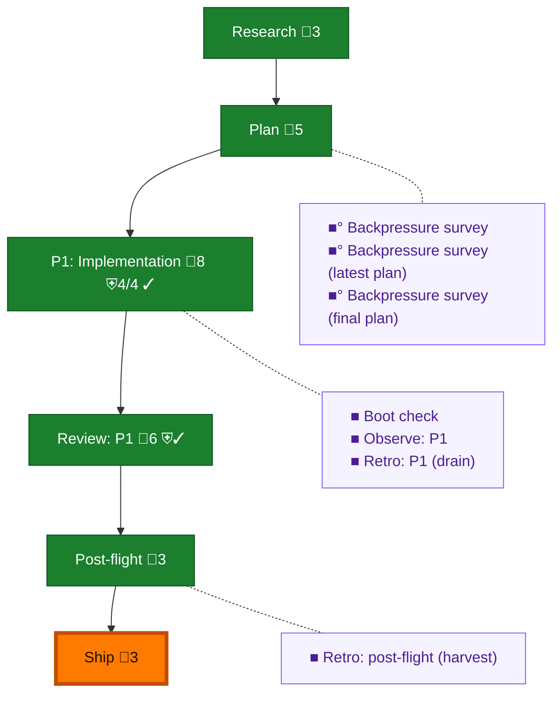

<!-- GENERATED by `harness flow render` — do not hand-edit; regenerate from the flow JSON. -->
# Flow · omp-statusline-name

**Kind**: flight-plan · **Now**: ship · **Intent**: Make the pij seat id reliably appear in the OMP status bar · **Nodes**: 13 · **Events**: 32

**Rail**: ◆─◆─[ ◆─◆─◐ ]─◆  ◆ Research · ◆ Plan · [ ◆ P1: Implementation · ◆ Review: P1 · ◐ Ship ] · ◆ Post-flight

**Legend** — colour = type/status: 🟩 done · 🟢 in-progress · 🟥 blocked · 🟦 known · ⬜ assumed · 🔶 decision · 🗣 user input · 🟪 harness chore (faded = not yet done) · 🤖 companion · 🛠 worker · 🟧 current (you are here). Badges: 💬 comments · 📄 artifacts · 📝 instructions · 🧰 chore (° optional / recommended / ‼ strongly-recommended; ✓ done · ✕ skipped) · ⛨ dd gate (terminal/total from the last evaluation; ✓ = open). ⛨✓/⛨✕ = a plan-validate check gate (green / not green).

## Node log

### backpressure · Backpressure survey
- `2026-09-01T21:36:49.159Z` · agent · validation — decision:approved verdict:Partial artifact:docs/plans/125-omp-statusline-name/assets/backpressure-coverage.md time:2026-09-01T21:36:00Z basis_sha256:049bd7d6abd29003c5517b0ff7a6eb32fe5b6d00b55e808f1f9f6efc3a92c2e7

### boot-1 · Boot check
- `2026-09-01T21:39:19.507Z` · agent · validation — verdict:HEALTHY command:harness-boot ready:true typecheck:pass test:pass time:2026-09-01T21:38:51.494Z

### observe-1 · Observe: P1
- `2026-09-01T22:01:21.000Z` · agent · validation — captures:3 pointer:.harness/temp/agent/session-buffer.md ids:CONF-001,DL-001,DL-002 time:2026-09-01T22:01:30Z

### retro-1 · Retro: P1 (drain)
- `2026-09-01T22:01:53.074Z` · agent · validation — verdict:listed-only owner:o-prime observations:3 pointer:.harness/temp/agent/session-buffer.md time:2026-09-01T22:01:30.821Z packet-rule:list-never-clear

### retro-harvest · Retro: post-flight (harvest)
- `2026-09-01T23:15:51.006Z` · agent · validation — verdict:ok records:0 buffer_pending:5 owner:o-prime action:list-never-clear time:2026-09-01T23:15:29.141Z experiences:.agents-skills-port/pij-team/EXPERIENCES.md

### backpressure-2dec7c839a80 · Backpressure survey (latest plan)
- `2026-09-01T21:38:26.064Z` · agent · validation — decision:approved verdict:Partial artifact:docs/plans/125-omp-statusline-name/assets/backpressure-coverage.md time:2026-09-01T21:38:30Z basis_sha256:2dec7c839a800c65e1932b0d2968a8770e65e80aab789ad31f8a28bddf32ce35

### backpressure-0ebf3f91cb65 · Backpressure survey (final plan)
- `2026-09-01T23:05:41.151Z` · agent · validation — decision:approved verdict:Partial artifact:docs/plans/125-omp-statusline-name/assets/backpressure-coverage.md time:2026-09-01T23:05:00Z basis_sha256:0ebf3f91cb656c8c1e21c3eeb802670ecf7caf67b78464fe165c58f052cfd5c4
