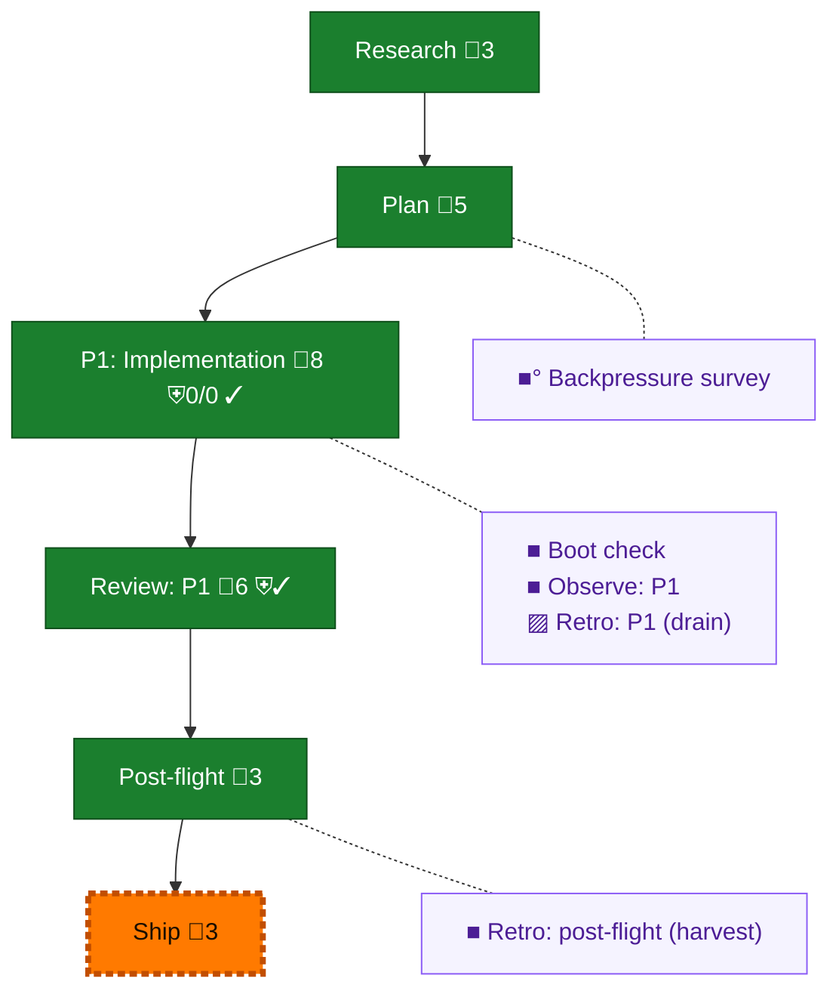

<!-- GENERATED by `harness flow render` — do not hand-edit; regenerate from the flow JSON. -->
# Flow · claude-inbound-accept-global

**Kind**: flight-plan · **Now**: ship · **Intent**: Implement plan 126 claude-inbound-accept-global · **Nodes**: 11 · **Events**: 25

**Rail**: ◆─◆─[ ◆─◆─◇ ]─◆  ◆ Research · ◆ Plan · [ ◆ P1: Implementation · ◆ Review: P1 · ◇ Ship ] · ◆ Post-flight

**Legend** — colour = type/status: 🟩 done · 🟢 in-progress · 🟥 blocked · 🟦 known · ⬜ assumed · 🔶 decision · 🗣 user input · 🟪 harness chore (faded = not yet done) · 🤖 companion · 🛠 worker · 🟧 current (you are here). Badges: 💬 comments · 📄 artifacts · 📝 instructions · 🧰 chore (° optional / recommended / ‼ strongly-recommended; ✓ done · ✕ skipped) · ⛨ dd gate (terminal/total from the last evaluation; ✓ = open). ⛨✓/⛨✕ = a plan-validate check gate (green / not green).

## Node log

### backpressure · Backpressure survey
- `2026-09-01T22:29:30.557Z` · agent · validation — decision:route verdict:partial artifact:assets/backpressure-coverage.md basis_sha256:e111e558459e9b277ccd4801b6b1a76d3fd95409ed38737894ab50869ada5bcc time:2026-09-01T22:29:24Z

### boot-1 · Boot check
- `2026-09-01T22:46:15.903Z` · agent · validation — decision:route verdict:UNAVAILABLE reason:harness-boot-timeout-180s user_ruling:continue-rust-with-cargo-and-final-harness-checks time:2026-09-01T22:35:57Z

### observe-1 · Observe: P1
- `2026-09-01T23:48:30.240Z` · agent · validation — decision:captured record:.harness/temp/agent/session-buffer.md entries:CONF-001,DL-001,DL-002,DL-003,DL-004,DL-005,DL-006,DL-007,CONF-002 time:2026-09-01T23:48:05Z

### retro-1 · Retro: P1 (drain)
- `2026-09-01T23:48:30.531Z` · user · decision — List, never clear — the drain is o-prime-owned.

### retro-harvest · Retro: post-flight (harvest)
- `2026-09-01T23:51:39.929Z` · agent · validation — decision:route verdict:harvest-complete records:0 buffer_pending:9 drain_owner:o-prime time:2026-09-01T23:51:07Z
