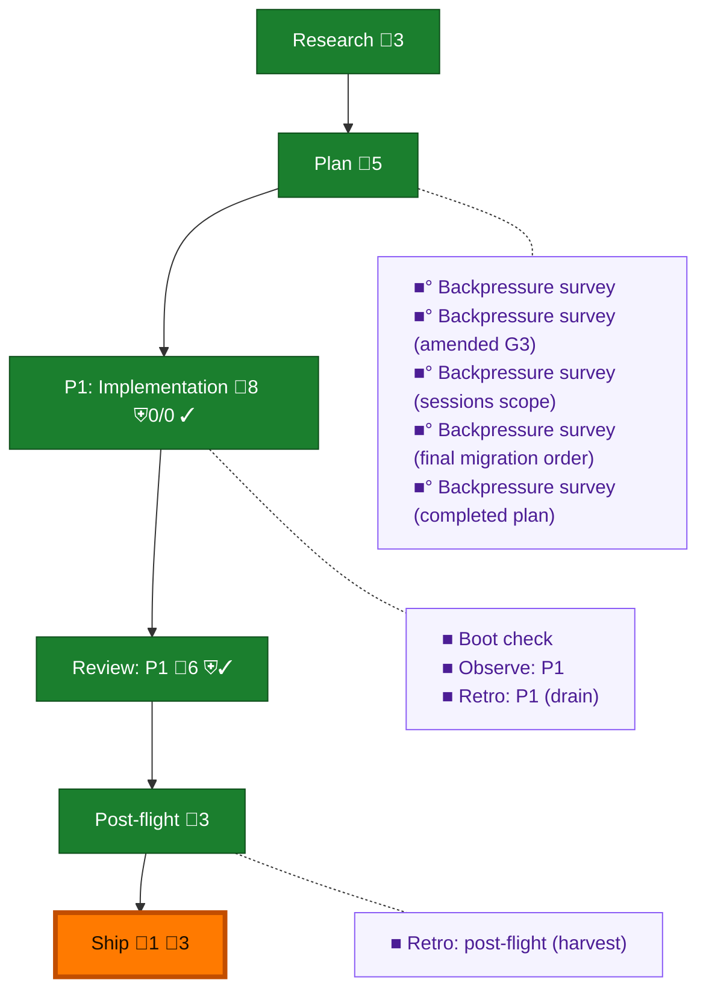

<!-- GENERATED by `harness flow render` — do not hand-edit; regenerate from the flow JSON. -->
# Flow · seat-session-identity

**Kind**: flight-plan · **Now**: ship · **Intent**: Implement plan 128 seat-session identity · **Nodes**: 15 · **Events**: 44

**Rail**: ◆─◆─[ ◆─◆─◆ ]─◆  ◆ Research · ◆ Plan · [ ◆ P1: Implementation · ◆ Review: P1 · ◆ Ship ] · ◆ Post-flight

**Legend** — colour = type/status: 🟩 done · 🟢 in-progress · 🟥 blocked · 🟦 known · ⬜ assumed · 🔶 decision · 🗣 user input · 🟪 harness chore (faded = not yet done) · 🤖 companion · 🛠 worker · 🟧 current (you are here). Badges: 💬 comments · 📄 artifacts · 📝 instructions · 🧰 chore (° optional / recommended / ‼ strongly-recommended; ✓ done · ✕ skipped) · ⛨ dd gate (terminal/total from the last evaluation; ✓ = open). ⛨✓/⛨✕ = a plan-validate check gate (green / not green).

## Node log

### ship · Ship
- `2026-09-02T03:49:54.611Z` · agent · validation — verdict:shipped pr:https://github.com/AI-Substrate/pij/pull/351 checks:all-green time:2026-09-02

### backpressure · Backpressure survey
- `2026-09-02T00:10:52.933Z` · agent · validation — verdict:completed reason:coverage artifact written basis_sha256:b56d5564b4865271d90840823e1d5cb5aa4eb356908b97e11db7f36d1cbd6720 time:2026-09-02

### boot-1 · Boot check
- `2026-09-02T00:10:53.690Z` · agent · validation — verdict:healthy reason:harness boot passed typecheck and test after canonical node_modules link time:2026-09-02T00:10:24Z

### observe-1 · Observe: P1
- `2026-09-02T03:24:13.142Z` · agent · validation — verdict:completed reason:12 real observations captured record:.harness/temp/agent/session-buffer.md time:2026-09-02

### retro-1 · Retro: P1 (drain)
- `2026-09-02T03:24:13.816Z` · agent · validation — decision:delegated verdict:listed reason:packet requires list-never-clear and o-prime-owned drain; 12 entries preserved in .harness/temp/agent/session-buffer.md time:2026-09-02

### retro-harvest · Retro: post-flight (harvest)
- `2026-09-02T03:32:34.255Z` · agent · validation — verdict:completed reason:harvest found 0 committed plan records; 12 transient observations preserved for o-prime drain; highest-value lesson encoded in harness commits 09bf1ddd,11313f64,480e5ef3 time:2026-09-02

### backpressure-ccd718561165 · Backpressure survey (amended G3)
- `2026-09-02T00:33:40.517Z` · agent · validation — verdict:completed reason:coverage refreshed for rs-first null-fill union basis_sha256:ccd7185611657d1edbca1b8589aa5de233c4a4e0999cb071f106aede2f6c55c6 time:2026-09-02

### backpressure-445cc1bef0fe · Backpressure survey (sessions scope)
- `2026-09-02T00:57:46.898Z` · agent · validation — verdict:completed reason:coverage refreshed for merged-row repository scoping basis_sha256:445cc1bef0fea46e12c97ce565176af9761b3e5c076c5de553437afd27ee5a2c time:2026-09-02

### backpressure-54fbecf708cf · Backpressure survey (final migration order)
- `2026-09-02T02:22:56.212Z` · agent · validation — verdict:completed reason:coverage refreshed for final 0011/11 landing order basis_sha256:54fbecf708cfad58ce6e239c0a2fb8510486cc50d669ff590c4695992c1d4004 time:2026-09-02

### backpressure-9e058beb1ef9 · Backpressure survey (completed plan)
- `2026-09-02T03:23:01.711Z` · agent · validation — verdict:completed reason:coverage basis refreshed after final review and AC receipts basis_sha256:9e058beb1ef9e9bb4abb757e43022738f2671eed8df78a83d75c5bbbd0763a8f time:2026-09-02
