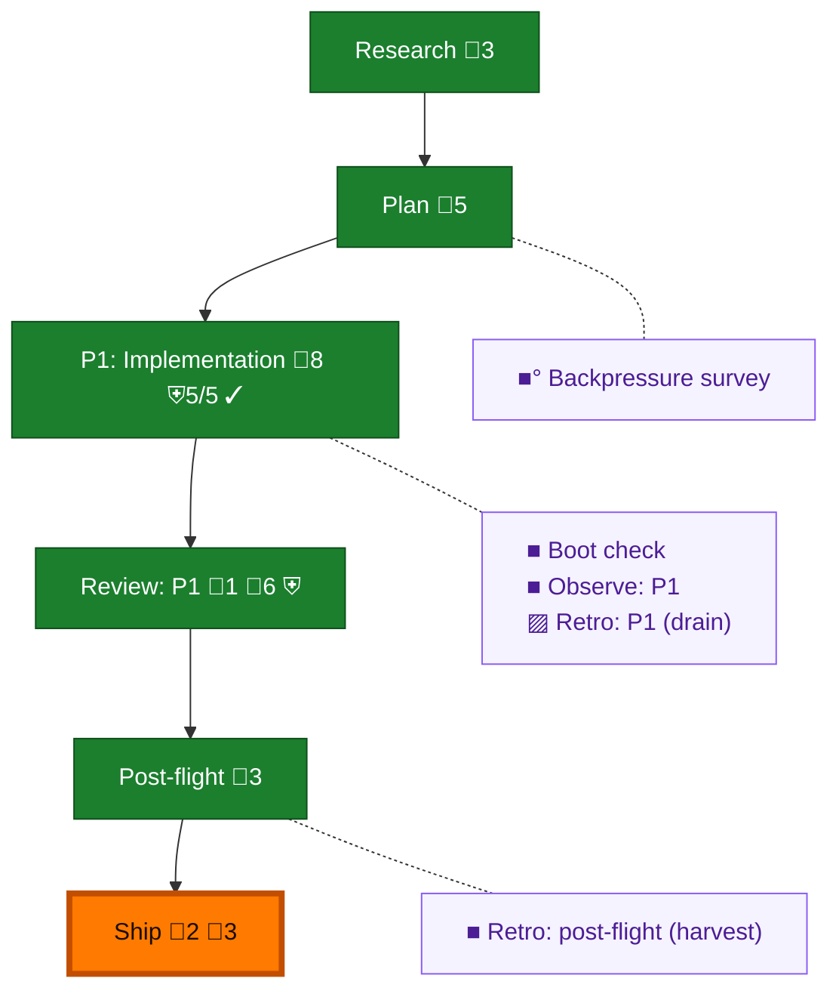

<!-- GENERATED by `harness flow render` — do not hand-edit; regenerate from the flow JSON. -->
# Flow · statusline-generation-badge

**Kind**: flight-plan · **Now**: ship · **Intent**: Show the rs-preferred seat id and generation badge in Claude and omp statuslines · **Nodes**: 11 · **Events**: 26

**Rail**: ◆─◆─[ ◆─◆─◆ ]─◆  ◆ Research · ◆ Plan · [ ◆ P1: Implementation · ◆ Review: P1 · ◆ Ship ] · ◆ Post-flight

**Legend** — colour = type/status: 🟩 done · 🟢 in-progress · 🟥 blocked · 🟦 known · ⬜ assumed · 🔶 decision · 🗣 user input · 🟪 harness chore (faded = not yet done) · 🤖 companion · 🛠 worker · 🟧 current (you are here). Badges: 💬 comments · 📄 artifacts · 📝 instructions · 🧰 chore (° optional / recommended / ‼ strongly-recommended; ✓ done · ✕ skipped) · ⛨ dd gate (terminal/total from the last evaluation; ✓ = open). ⛨✓/⛨✕ = a plan-validate check gate (green / not green).

## Node log

### review-1 · Review: P1
- `2026-09-02T03:54:36.343Z` · agent · validation — verdict:APPROVE receipt:docs/plans/129-statusline-generation-badge/assets/reviews/review-r2-cross-model.dd.md time:2026-09-02T03:54:18Z

### ship · Ship
- `2026-09-02T04:29:29.821Z` · agent · validation — verdict:all-green pr:https://github.com/AI-Substrate/pij/pull/353 checks:4-pass report:assets/ship/2026-09-02/ship-report.md time:2026-09-02T04:14:00Z
- `2026-09-02T04:30:03.507Z` · agent · validation — correction:prior-receipt-time-was-prefilled actual_completion_time:2026-09-02T04:29:42Z

### backpressure · Backpressure survey
- `2026-09-02T03:55:43.561Z` · agent · validation — decision:unavailable reason:late-adopted-dd-native-plan-has-no-unified-star-plan-input-required-by-backpressure-module time:2026-09-02T03:55:30Z

### boot-1 · Boot check
- `2026-09-02T01:57:20.671Z` · agent · validation — decision:route verdict:UNHEALTHY reason:harness-boot-test-failed time:2026-09-02T01:57:11.840Z
- `2026-09-02T01:58:20.612Z` · user · decision — decision:continue reason:prime ruled known-main baselines npm-resolution-policy.integration.test.ts replay status 1 and worktree.test.ts cleanup ENOTEMPTY; exclude only these named failures time:2026-09-02T01:58:18Z

### observe-1 · Observe: P1
- `2026-09-02T03:54:35.549Z` · agent · validation — decision:captured record:.harness/temp/agent/session-buffer.md entries:13 time:2026-09-02T03:54:18Z

### retro-1 · Retro: P1 (drain)
- `2026-09-02T03:54:35.861Z` · user · decision — List, never clear — the drain is o-prime-owned.

### retro-harvest · Retro: post-flight (harvest)
- `2026-09-02T03:55:43.843Z` · agent · validation — decision:route verdict:ok records:0 buffer_pending:13 reason:drain-is-o-prime-owned generated_at:2026-09-02T03:54:46.475Z
