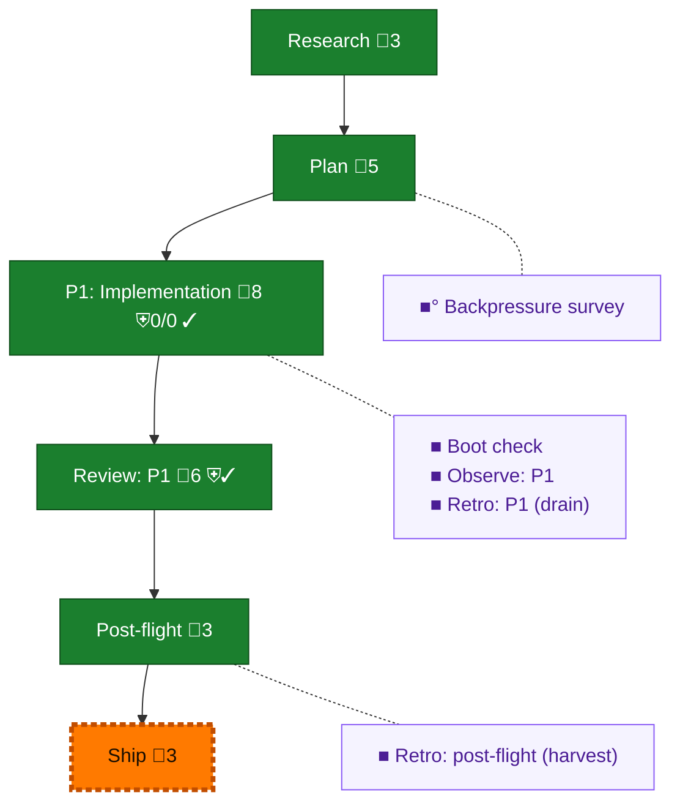

<!-- GENERATED by `harness flow render` — do not hand-edit; regenerate from the flow JSON. -->
# Flow · pij-rs-send-defaults

**Kind**: flight-plan · **Now**: ship · **Intent**: Implement plan 130 pij-rs send defaults · **Nodes**: 11 · **Events**: 21

**Rail**: ◆─◆─[ ◆─◆─◇ ]─◆  ◆ Research · ◆ Plan · [ ◆ P1: Implementation · ◆ Review: P1 · ◇ Ship ] · ◆ Post-flight

**Legend** — colour = type/status: 🟩 done · 🟢 in-progress · 🟥 blocked · 🟦 known · ⬜ assumed · 🔶 decision · 🗣 user input · 🟪 harness chore (faded = not yet done) · 🤖 companion · 🛠 worker · 🟧 current (you are here). Badges: 💬 comments · 📄 artifacts · 📝 instructions · 🧰 chore (° optional / recommended / ‼ strongly-recommended; ✓ done · ✕ skipped) · ⛨ dd gate (terminal/total from the last evaluation; ✓ = open). ⛨✓/⛨✕ = a plan-validate check gate (green / not green).

## Node log

### backpressure · Backpressure survey
- `2026-09-02T03:01:56.837Z` · agent · validation — decision:route verdict:Partial artifact:docs/plans/130-pij-rs-send-defaults/assets/backpressure-coverage.md basis_sha256:39d3d123ac83177b1c77a45f7b46baff6991d6be987ba3229aa830f3b090682f time:2026-09-02

### boot-1 · Boot check
- `2026-09-02T02:40:10.511Z` · agent · validation — verdict:UNHEALTHY reason:typecheck passed; just test failed in req-0044 baseline suites; prime explicitly ruled continue with named exclusions time:2026-09-02T02:39:54.468Z

### observe-1 · Observe: P1
- `2026-09-02T03:48:48.617Z` · agent · validation — decision:captured records:.harness/temp/agent/session-buffer.md ids:DL-001,DL-002,CONF-001,DL-003,CONF-002 time:2026-09-02T03:48:38.459Z drain-owner:o-prime

### retro-1 · Retro: P1 (drain)
- `2026-09-02T05:08:17.657Z` · agent · validation — decision:done verdict:o-prime-drained reason:all-8-entries-accepted-and-dispositioned receipt:/Users/jordanknight/pi-hacking/pij-worktrees/pij-governance/.harness/government/briefs/vendored-2026-09-02/plan-130-disposition.md time:2026-09-02

### retro-harvest · Retro: post-flight (harvest)
- `2026-09-02T06:09:13.507Z` · agent · validation — decision:done verdict:harvest-ok reason:harness-retro-insights-returned-0-repo-records-after-o-prime-governance-drain; encoded-improvement:f0a9a354-repairs-team-packet-doctrine-paths time:2026-09-02T06:09:02Z
