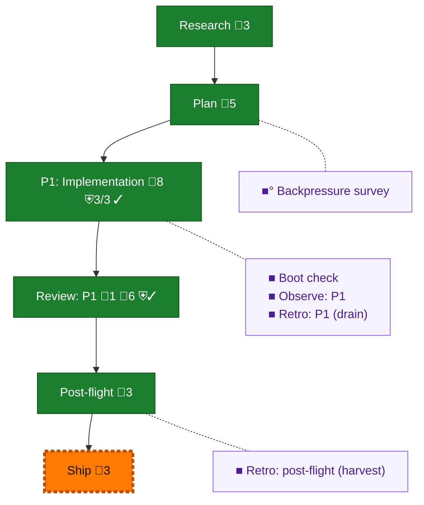

<!-- GENERATED by `harness flow render` — do not hand-edit; regenerate from the flow JSON. -->
# Flow · baseline-red-tests

**Kind**: flight-plan · **Now**: ship · **Intent**: Deliver baseline-red test fixes per plan 131 · **Nodes**: 11 · **Events**: 26

**Rail**: ◆─◆─[ ◆─◆─◇ ]─◆  ◆ Research · ◆ Plan · [ ◆ P1: Implementation · ◆ Review: P1 · ◇ Ship ] · ◆ Post-flight

**Legend** — colour = type/status: 🟩 done · 🟢 in-progress · 🟥 blocked · 🟦 known · ⬜ assumed · 🔶 decision · 🗣 user input · 🟪 harness chore (faded = not yet done) · 🤖 companion · 🛠 worker · 🟧 current (you are here). Badges: 💬 comments · 📄 artifacts · 📝 instructions · 🧰 chore (° optional / recommended / ‼ strongly-recommended; ✓ done · ✕ skipped) · ⛨ dd gate (terminal/total from the last evaluation; ✓ = open). ⛨✓/⛨✕ = a plan-validate check gate (green / not green).

## Node log

### review-1 · Review: P1
- `2026-09-02T04:04:41.380Z` · agent · validation — Claude Opus 5 round 2: APPROVE; prerelease fail-open and lock-replay comment fixed; 4 files / 21 tests passed; no further review round needed. · refs: 28b84b17

### backpressure · Backpressure survey
- `2026-09-02T02:38:52.614Z` · agent · validation — verdict:Strong reason:4 RUN, 0 gaps; artifact assets/backpressure-coverage.md; basis_sha256:c0ff2fd4bda28a2b7fad34ca4a7dbfba8cf305693be3d039572c1ac47051098d time:2026-09-02

### boot-1 · Boot check
- `2026-09-02T02:43:09.854Z` · agent · validation — verdict:UNHEALTHY reason:typecheck passed; just test failed in unrelated cli.integration.test.ts spawn assertion (received 143); time:2026-09-02

### observe-1 · Observe: P1
- `2026-09-02T03:40:31.587Z` · agent · validation — verdict:captured reason:6 in-flight observations recorded (CONF-001/002, DL-001..004); buffer .harness/temp/agent/session-buffer.md; time:2026-09-02

### retro-1 · Retro: P1 (drain)
- `2026-09-02T03:40:32.104Z` · agent · validation — verdict:attempted reason:harness observe --list --json succeeded; governance assigns drain/clear to o-prime, so PM left the six entries buffered; time:2026-09-02

### retro-harvest · Retro: post-flight (harvest)
- `2026-09-02T04:07:19.294Z` · agent · validation — decision:route hook:post-flight harvest:ok records:1 entries:8 buffer_pending:0 highest_value:SUGG-001-supported-npm-enforcement-matrix time:2026-09-02T04:07:04Z
