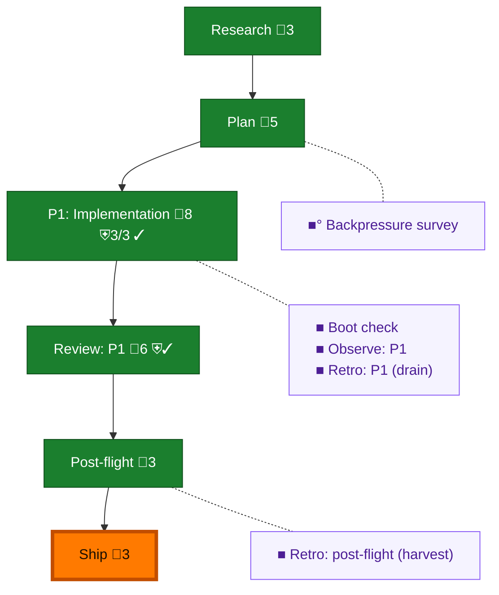

<!-- GENERATED by `harness flow render` — do not hand-edit; regenerate from the flow JSON. -->
# Flow · spawn-reports-bind

**Kind**: flight-plan · **Now**: ship · **Intent**: pij-rs spawn distinguishes dispatched from bound and reports early child failure evidence · **Nodes**: 11 · **Events**: 25

**Rail**: ◆─◆─[ ◆─◆─◆ ]─◆  ◆ Research · ◆ Plan · [ ◆ P1: Implementation · ◆ Review: P1 · ◆ Ship ] · ◆ Post-flight

**Legend** — colour = type/status: 🟩 done · 🟢 in-progress · 🟥 blocked · 🟦 known · ⬜ assumed · 🔶 decision · 🗣 user input · 🟪 harness chore (faded = not yet done) · 🤖 companion · 🛠 worker · 🟧 current (you are here). Badges: 💬 comments · 📄 artifacts · 📝 instructions · 🧰 chore (° optional / recommended / ‼ strongly-recommended; ✓ done · ✕ skipped) · ⛨ dd gate (terminal/total from the last evaluation; ✓ = open). ⛨✓/⛨✕ = a plan-validate check gate (green / not green).

## Node log

### backpressure · Backpressure survey
- `2026-09-02T02:40:06.614Z` · agent · validation — decision:unavailable reason:backpressure module requires a unified *-plan.md with Business Specification and Implementation Plan headings; plan 132 is dd-native plan.dd.md and has neither time:2026-09-02T02:39:59Z basis_sha256:363fde0a0e3991cde408bc31254af835954046a59771f376531800d3a8ee4a2e

### boot-1 · Boot check
- `2026-09-02T02:45:14.955Z` · agent · validation — verdict:UNHEALTHY reason:harness boot typecheck passed; just test failed at harness/scripts/npm-resolution-policy.integration.test.ts:536 expected 0 received 1 time:2026-09-02T02:44:11.931Z

### observe-1 · Observe: P1
- `2026-09-02T09:18:02.451Z` · agent · validation — decision:captured record:.harness/temp/agent/session-buffer.md observations:list-preserved-per-prime time:2026-09-02T09:17:39Z

### retro-1 · Retro: P1 (drain)
- `2026-09-02T09:18:02.732Z` · agent · validation — decision:deferred reason:PM-packet-assigns-drain-to-o-prime evidence:harness-observe-list-ok time:2026-09-02T09:17:39Z

### retro-harvest · Retro: post-flight (harvest)
- `2026-09-02T09:19:47.561Z` · agent · validation — decision:route verdict:retro-insights-ok records:0 buffer:preserved-for-o-prime time:2026-09-02T09:19:27Z
